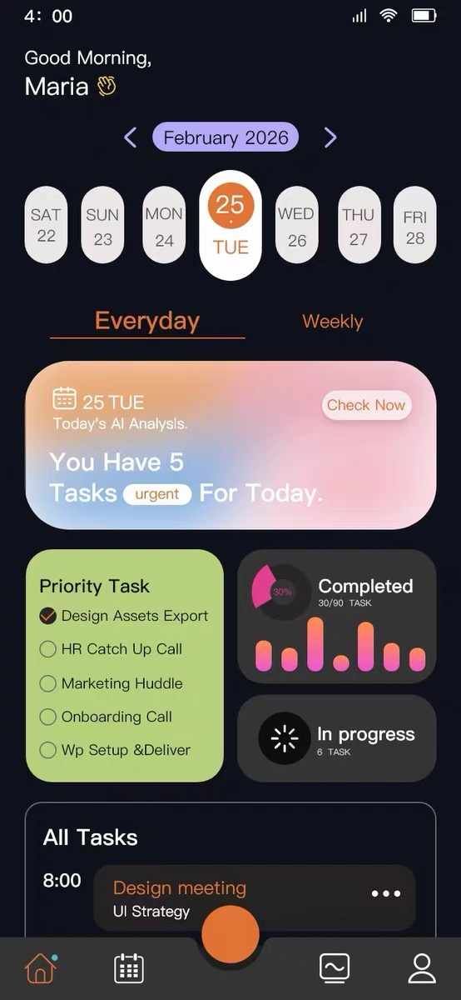
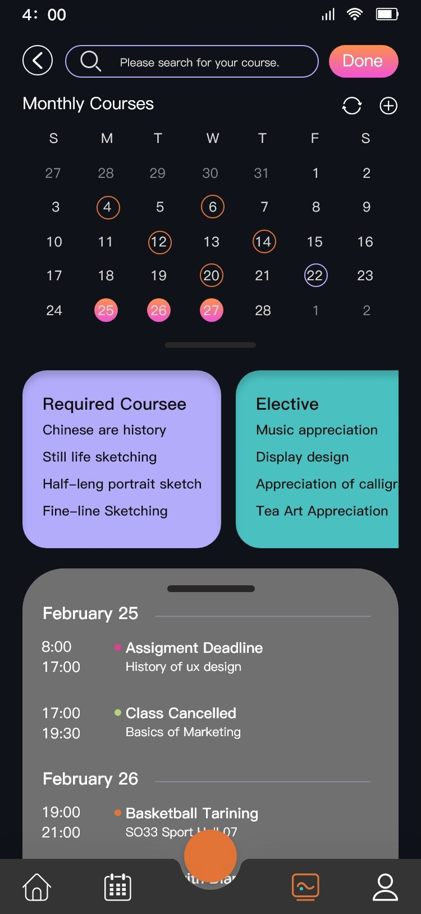
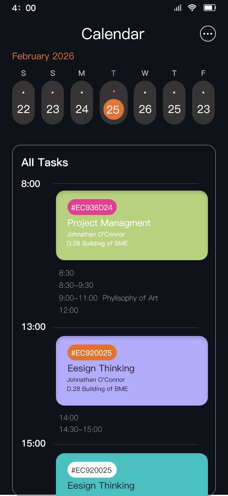
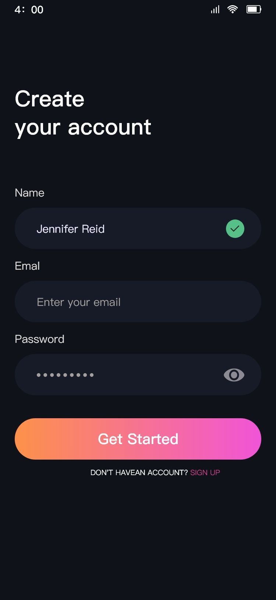
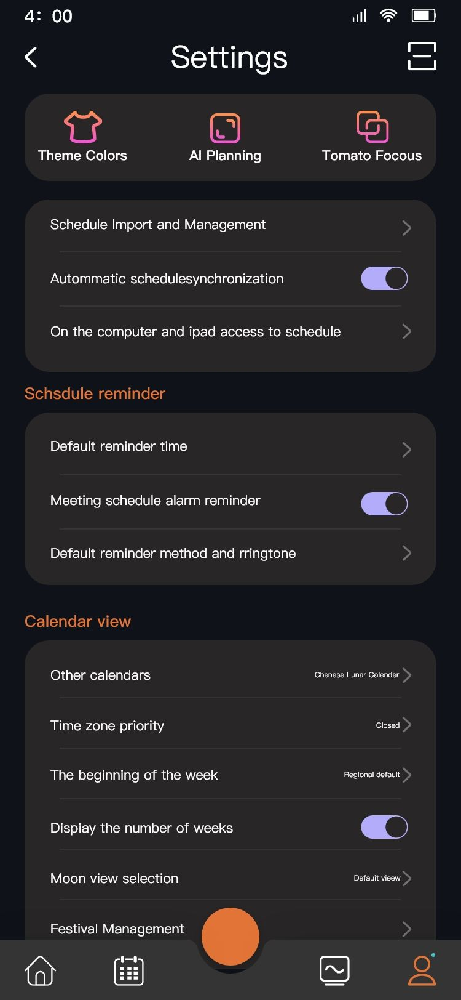

# CampusTodo — AI-Assisted Campus Task Manager

[](https://github.com/hwq-is-sunny/to-do-list/actions/workflows/android-ci.yml)

CampusTodo is a portfolio project focused on converting unstructured campus notices into reviewable tasks, while keeping local-first task and timetable management usable without an AI provider.

CampusTodo is an Android app for organizing university coursework, schedules, and reminders. It combines local rule-based parsing with optional LLM assistance to turn unstructured campus notices into reviewable task candidates.

> **Project status:** undergraduate prototype. The repository describes the implementation as it exists today; security controls in a client application are defense-in-depth, not a substitute for a trusted backend.

## Core capabilities

- **Task management:** create, update, complete, and delete tasks.
- **Course and timetable management:** store courses and weekly class slots.
- **Calendar and reminders:** review upcoming tasks and schedule local notifications.
- **Candidate inbox:** preserve imported text, parse it into a draft, and let the user confirm before creating a task.
- **Rule-based notice parsing:** extract likely task titles, dates, times, locations, categories, and priority hints from Chinese campus notices.
- **Duplicate suggestions:** score candidate tasks using title, course, and due-time similarity before suggesting a merge.
- **Optional AI assistance:** call a compatible chat-completions endpoint to parse notices or structure timetable OCR text.
- **Timetable OCR support:** use ML Kit text recognition and optional LLM structuring to help convert a timetable image into rows for review.

## Screenshots

The repository includes screenshots of the main user flows:

| Today / tasks | Calendar | Courses / timetable |
|---|---|---|
|  |  |  |

| Login | Settings |
|---|---|
|  |  |

## Architecture at a glance

```text
Compose UI
   |
ViewModel / UI state
   |
Repository
   |-----------------------|
Room / SQLite          Domain parsing
                           |
                  Rule-based notice parser
                           |
                    Candidate draft
                           |
                 Duplicate-score suggestion
                           |
                 User review and confirmation

Optional AI path:
Input validation -> LLM request -> output validation -> reviewable draft
```

The LLM output is treated as a suggestion, not as an instruction to perform an action. The user remains in the confirmation loop before a parsed candidate becomes a task.

## Technology stack

| Area | Technology |
|---|---|
| Language | Kotlin |
| UI | Android, Jetpack Compose, Material 3 |
| Architecture | ViewModel + Repository |
| Local database | Room / SQLite |
| Preferences | Preferences DataStore |
| Async work | Kotlin Coroutines / Flow |
| Reminders | WorkManager and Android notifications |
| HTTP | OkHttp |
| OCR | Google ML Kit Chinese text recognition |
| AI integration | Configurable chat-completions API |

Build configuration currently uses **Android Gradle Plugin 8.2.2**, **Gradle 8.2.1**, **Kotlin 1.8.22**, **Java/JVM target 17**, **compile SDK 34**, and **minimum SDK 26**. The wrapper version is aligned with the AGP 8.2 generation and the Foojay toolchain resolver used in settings. Use Android SDK Platform 34 and JDK 17 for this project configuration.

## Run locally

1. Install JDK 17 and Android Studio with Android SDK Platform 34.
2. Clone the repository:
   ```bash
   git clone https://github.com/hwq-is-sunny/to-do-list.git
   cd to-do-list
   ```
3. Open the project root in Android Studio and allow Gradle sync to finish.
4. Run the app on an Android device or emulator.
5. If you want to use AI features, configure the provider URL, model, and a **test API key** in the app's AI settings. AI features can be left disabled if no key is configured.

Do **not** commit `local.properties`, API keys, access tokens, or other credentials.

## Security notes

This branch adds client-side validation around the optional LLM path:

- Limit the size of imported notice and OCR text before sending it to a model.
- Use heuristic checks for a small set of high-confidence prompt-injection phrases.
- Tell the model to treat imported content as untrusted data, not as instructions.
- Validate structured task fields, enum values, dates, times, and confidence values before creating a suggestion.
- Validate the expected five-column format of AI-structured timetable rows.
- Avoid baking a provider API key into `BuildConfig` or the APK.

**Limitations:** phrase matching is heuristic and can be bypassed or produce false positives. Client-side checks do not create a trustworthy security boundary. The API key is encrypted at rest with AES-GCM using an Android Keystore key. The app disables Android backup entirely to avoid exporting local credentials; this also means local tasks and settings are not backed up automatically. Do not use a valuable production key or send sensitive data through this prototype. The app uses local-only demo accounts and does not provide server-side authentication or multi-device account isolation. A production deployment should route model calls through an authenticated backend, keep provider credentials server-side, apply server-side rate limits, minimize logs, and define a data-retention policy.

## Quality checks

The GitHub Actions workflow runs on pushes to main and pull requests targeting main:

- ./gradlew testDebugUnitTest — unit tests for AI input/output validation, password hashing and legacy-hash upgrade detection, notice date/time parsing, and duplicate-task scoring.
- ./gradlew lintDebug — Android static analysis.
- ./gradlew assembleDebug and ./gradlew assembleRelease — compile and package both build variants.
- Uploads the debug APK and test/lint reports as workflow artifacts.

Download the latest debug APK from the Artifacts section of a successful [Actions run](https://github.com/hwq-is-sunny/to-do-list/actions). This is a debug build for demonstration, not a Play Store release.

## Implemented vs. future work

Implemented in the current codebase:
- local task/course/timetable persistence;
- candidate import and confirmation flow;
- local notice parsing and duplicate suggestions;
- reminder scheduling;
- optional LLM-based notice parsing and timetable structuring;
- client-side validation for LLM inputs and outputs.

Not implemented by this repository:
- a production AI gateway/backend;
- server-side authentication, quotas, or rate limiting;
- a production-grade encrypted credential store;
- a comprehensive prompt-injection defense;
- formal security testing or an independent security audit.

## Project links

- Repository: https://github.com/hwq-is-sunny/to-do-list

This is a learning and portfolio project. Verify the current source and test results before relying on any feature or security claim.
